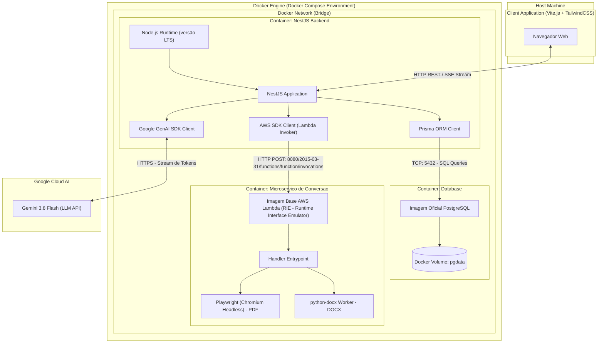

# 🎓 Teachy Test — Copiloto de Planejamento Pedagógico com IA

Repositório monorepo do teste técnico Teachy: um copiloto pedagógico inteligente projetado para co-criar planejamentos escolares da Educação Básica brasileira em diálogo interativo com professores, persistindo dados estruturados de forma incremental e exibindo uma pré-visualização paginada em tempo real (_Living Draft_).

---

## 🏛️ Arquitetura da Solução

O projeto adota uma arquitetura desacoplada e orientada a serviços conteinerizados via Docker Compose, separando com rigor as responsabilidades entre interface web, backend de orquestração pedagógica, microsserviço de renderização de alta fidelidade e persistência de dados.

### Diagrama de Arquitetura

<p align="center">
  
</p>

<details>
<summary><b>Visualizar diagrama interativo em formato Mermaid</b></summary>


</details>

### Detalhamento dos Componentes

1. **Host Machine & Client Application (`apps/web`):**
   - **Tecnologias:** React 19, Vite.js, Tailwind CSS v4, TanStack Router e design system com Radix UI / shadcn/ui.
   - **Navegador Web:** Executado diretamente na máquina host (`http://localhost:5173`), entregando ao professor uma experiência fluida de co-criação.
   - **Comunicação Híbrida Segregada:**
     - **Streaming em Tempo Real (SSE):** Consumo contínuo de tokens pedagógicos da IA via Server-Sent Events, com suporte a cancelamento cooperativo instantâneo (*cancel mid-flight*) através de `AbortController`.
     - **REST Tradicional (`async/await`):** Operações determinísticas de CRUD, paginação, download de arquivos e recuperação de dados de sessões.
   - **Living Draft:** Visualizador em tempo real paginado em padrão folha A4 com renderização precisa do planejamento em co-criação.

2. **Docker Engine (`apps/service/docker-compose.yml`):**
   - Orquestra os contêineres locais interconectados através de uma rede bridge isolada (`Docker Network Bridge`), garantindo reprodutibilidade idêntica do ambiente.

3. **Container: Backend Core (`apps/service` — `teachy_service`):**
   - **Runtime:** Node.js (versão LTS).
   - **Framework:** NestJS com modularização estrita e Casos de Uso atômicos (`PlanningModule`, `AiModule`, `CatalogModule`).
   - **Clientes & Integrações Centrais:**
     - **Prisma ORM Client:** Mapeamento objeto-relacional com schemas modulares em `prisma/models/`, gerenciando transações ACID, integridade referencial e o catálogo oficial da BNCC.
     - **AWS SDK Client (Lambda Invoker):** Despacha requisições de conversão ao microsserviço de renderização via protocolo padrão AWS Lambda RIE, isolando I/O gráfico pesado do backend principal.
     - **Google GenAI SDK Client:** Interface com o modelo **Gemini 3.8 Flash**, injetando o estado atual do banco como *Snapshot Único da Verdade*, aplicando guardrails pedagógicos e processando o transformador de saída dupla (`DualOutputStreamTransformer`) para separar o diálogo humano do payload estruturado oculto (`<!--PLANNING_PATCH: ... -->`).

4. **Container: Database (`teachy_postgres`):**
   - **Imagem Oficial:** `postgres:16-alpine`.
   - **Persistência:** Volume gerenciado `postgres_data` (`/var/lib/postgresql/data`), assegurando persistência durável dos dados entre reinicializações.
   - **Massa de Dados:** Armazena as 1.705 habilidades canônicas da BNCC, componentes curriculares, histórico cronológico de conversas e os planejamentos hierárquicos e dinâmicos (padrão EAV com `Specification`).
   - **Conexão:** `TCP: 5432` com pool de conexões otimizado pelo Prisma.

5. **Container: Microserviço de Conversão (`apps/engine` — `teachy_engine`):**
   - **Imagem Base:** `public.ecr.aws/lambda/python:3.12` com Amazon Linux 2023 e AWS Lambda RIE (*Runtime Interface Emulator*) embutido.
   - **Paridade Cloud:** Permite invocações idênticas às de uma função AWS Lambda Serverless através de `HTTP POST: 8080/2015-03-31/functions/function/invocations`.
   - **Motores de Renderização Especializados:**
     - **Playwright (Chromium Headless) - PDF:** Executa o Chromium headless para compilar o HTML/CSS do planejamento diretamente para PDF A4 (retrato ou paisagem), garantindo exata paridade visual com a interface.
     - **python-docx Worker - DOCX:** Constrói documentos nativos do Microsoft Word / Google Docs (`.docx`) com tabelas formatadas, células editáveis, cabeçalhos sombreados e metadados dinâmicos.

6. **Google Cloud AI (Serviço Externo):**
   - **Modelo:** `Gemini 3.8 Flash` (Google Cloud Generative AI).
   - **Comunicação:** Conexão criptografada `HTTPS` com streaming de tokens em tempo real.
   - **Papel Pedagógico:** Atua como copiloto investigativo e socrático para estruturar planos de aula, sugerir metodologias ativas e alinhar códigos e habilidades curriculares à realidade escolar brasileira.

### Resumo das Comunicações & Protocolos

| Origem | Destino | Protocolo / Porta | Finalidade |
| :--- | :--- | :--- | :--- |
| **Navegador Web (`apps/web`)** | **NestJS Backend (`apps/service`)** | `HTTP REST` / `SSE Stream` (`:3000`) | Envio de comandos, upload de materiais, streaming de respostas da IA e consultas |
| **NestJS Backend (`apps/service`)** | **PostgreSQL (`teachy_postgres`)** | `TCP: 5432` (SQL Queries via Prisma) | Persistência transacional, catálogo da BNCC e consultas relacionais |
| **NestJS Backend (`apps/service`)** | **Engine Lambda (`teachy_engine`)** | `HTTP POST: 8080/2015-03-31/...` (RIE) | Invocação assíncrona para renderização de alta fidelidade em PDF e DOCX |
| **NestJS Backend (`apps/service`)** | **Google Cloud AI** | `HTTPS` (Stream de Tokens) | Geração de linguagem natural e emissão de patches estruturados da IA |

---

## 🧠 Tomada de Decisão: Linha Cronológica de Raciocínio

Abaixo está o registro cronológico das decisões de arquitetura, modelagem e produto ao longo do desenvolvimento, detalhando o que foi pensado e a linha de raciocínio adotada em cada etapa:

1. **[#1 - feat(service): configurar Prisma ORM, PostgreSQL e Docker Compose](https://github.com/azevgabriel/teachy-test/issues/1)**

   > **Linha de raciocínio:** Antes de qualquer regra de negócio, era indispensável ter uma base de persistência local reprodutível, isolada e simples de rodar. Optei pelo PostgreSQL conteinerizado via Docker Compose e estruturei o Prisma ORM v7 com suporte nativo a schemas modulares em `prisma/models/`, permitindo que cada domínio de dados cresça em seu próprio arquivo sem criar um monólito de schema, além de disponibilizar scripts automáticos para geração do `.env`.

2. **[#3 - feat(service): modelar habilidades da BNCC, componentes curriculares, anos de aplicacao e pipeline de seed](https://github.com/azevgabriel/teachy-test/issues/3)**

   > **Linha de raciocínio:** Um copiloto pedagógico para o contexto brasileiro não pode depender de alucinações da LLM para códigos ou descrições curriculares. Decidi modelar relacionalmente as 1.705 habilidades oficiais da BNCC estruturadas por ano e componente (incluindo disciplinas tradicionais, campos de experiência e computação) e desenvolver uma pipeline de seed idempotente a partir de dados reais para alimentar o banco com dados canônicos.

3. **[#5 - feat: interacao humana com a llm (chat, streaming, persistencia e linha do tempo de sessoes)](https://github.com/azevgabriel/teachy-test/issues/5)**

   > **Linha de raciocínio:** Precisávamos validar a experiência conversacional o quanto antes. O foco foi viabilizar streaming Server-Sent Events (SSE) com o Google Gemini, isolamento de sessões com histórico ordenado cronologicamente, controle de interrupção instantânea (botão Stop cooperativo sem quebrar estado) e persistência auditável de cada mensagem trocada.

4. **[#7 - feat(database): modelagem relacional do Planejamento Escolar e Avaliações flexíveis](https://github.com/azevgabriel/teachy-test/issues/7)**

   > **Linha de raciocínio:** O planejamento não podia ser um texto livre ou JSON opaco; precisava ser uma estrutura relacional viva para permitir edições pontuais, validação curricular e exportação fiel. Modelei um núcleo enxuto (`Planning` para o cabeçalho macro e `PlanningBlock` com auto-relacionamento recursivo `parentId` para o cronograma temporal), complementado pelo padrão EAV (`Specification` e `PlanningMetadataValue`) para absorver qualquer coluna ou metadado customizado solicitado pelo professor, além de modelagem flexível de instrumentos e critérios avaliativos.

5. **[#10 - feat(docs): especificação de orquestração pedagógica, guardrails e especificações padrão](https://github.com/azevgabriel/teachy-test/issues/10)**

   > **Linha de raciocínio:** Antes de instruir a LLM a interagir com o banco de dados, era vital formalizar as regras pedagógicas do sistema. Documentei as diretrizes em `apps/service/docs/planning/`: a regra anti-dump (proibição de despejar tabelas inteiras no chat de texto), a régua de granularidades decrescente, o tom co-criativo e investigativo da IA e a flexibilidade da BNCC para acomodar recomposição de aprendizagem (defasagens) e turmas adiantadas.

6. **[#11 - feat(ai): modularização de system prompts, fases do agente e higiene de contexto](https://github.com/azevgabriel/teachy-test/issues/11)**

   > **Linha de raciocínio:** Prompts estáticos e gigantescos degradam o raciocínio da IA e aumentam a chance de alucinação. Modularizei as instruções em arquivos temáticos especializados (`base`, `pedagogical-rules`, `evaluation-rules`, `intent-matrix`, `phases/`) e criei o `SystemInstructionBuilder`, injetando o estado atual do banco como "Snapshot Único da Verdade" e higienizando rigorosamente mensagens interrompidas ou canceladas da janela de contexto enviada ao modelo.

7. **[#12 - feat(ai): protocolo de saída dupla (streaming visual + payload estruturado oculto)](https://github.com/azevgabriel/teachy-test/issues/12)**

   > **Linha de raciocínio:** O professor deve receber apenas texto pedagógico acolhedor em Markdown limpo, sem nunca ver payloads técnicos de banco. Criei um transformador de stream com buffer de lookahead (`DualOutputStreamTransformer`) que transmite a resposta humana pelo SSE em tempo real e suprime do canal visual o envelope estruturado posicionado ao final (`<!--PLANNING_PATCH: ... -->`), validado estritamente com schemas Zod.

8. **[#13 - feat(backend): casos de uso para persistência incremental do planejamento (PlanningModule)](https://github.com/azevgabriel/teachy-test/issues/13)**

   > **Linha de raciocínio:** Com os comandos estruturados gerados pela IA, estruturei o `PlanningModule` com Casos de Uso atômicos e transacionais (`UpsertPlanning`, `SwapBlockByDate`, `AddSpecificationWithSlots`, `BatchUpdateColumn`, `ReorganizeHierarchy`, etc.). Garanti que mutações só sejam despachadas após o término seguro do stream (zero mutações em mensagens canceladas) e que os comandos fiquem armazenados na coluna auditável `Conversation.commands`.

9. **[#15 - fix(database): adicionar coluna is_required no modelo de Specification](https://github.com/azevgabriel/teachy-test/issues/15)**

   > **Linha de raciocínio:** Durante o refinamento do fluxo, identifiquei a necessidade de distinguir colunas opcionais de colunas de preenchimento mandatório pelo professor (ex: "é obrigatório preencher os recursos didáticos"). Adicionei a coluna `is_required` no modelo `Specification` com `@default(false)` para manter retrocompatibilidade e permitir tanto a validação na interface quanto o mecanismo de _slot-filling_ da IA antes da conclusão do plano.

10. **[#22 - feat(specifications): visual visibility control, label omission, universal reordering and native field reuse](https://github.com/azevgabriel/teachy-test/issues/22)**

    > **Linha de raciocínio:** Ao testar comandos reais dos professores, observei três problemas de usabilidade: trocar o nome de campos nativos (ex: de \"Componente\" para \"Disciplina\") gerava cartões duplicados em vez de atualizar o `customLabel`; não era possível omitir o rótulo superior para exibir apenas o valor direto; e não havia como ocultar seções sem deletar dados do banco. Adicionei os campos `order`, `isVisible` e `showLabel` ao modelo `Specification`, unificando o controle de colunas nativas e dinâmicas com integridade.

11. **[#23 - fix(planning): resolução precisa de applicationYear, curricularComponents e higiene de contexto pós-reset](https://github.com/azevgabriel/teachy-test/issues/23)**

    > **Linha de raciocínio:** Detectei falhas críticas de ambiguidade semântica: \"3º Ano do EM\" era incorretamente associado ao \"3º ano do EF I\" por busca parcial genérica, e \"Língua Portuguesa\" caía em campos de experiência da Educação Infantil. Além disso, ao disparar `RESET_PLANNING`, o histórico mantinha resíduos da conversa anterior. Criei resolvedores determinísticos desambiguados por etapa de ensino e implementei uma demarcação de corte (_watermark_) que purga o histórico conversacional anterior ao recomeço.

12. **[#26 - feat(ai/planning): motor de agrupamento e subdivisão temporal de blocos via chat (REORGANIZE_TREE)](https://github.com/azevgabriel/teachy-test/issues/26)**

    > **Linha de raciocínio:** Identifiquei um falso positivo conversacional grave: quando o professor pedia \"subdivida os meses em semanas\", a IA respondia elogiando a estrutura pedagógica, mas não criava nenhum bloco no banco de dados. Bloqueei essa resposta puramente retórica nos prompts com um guardrail mandatório, reformulei o Snapshot para exibir a árvore de blocos com indentação visual clara e aprimorei o `ReorganizeHierarchyUseCase` para calcular semanas úteis do calendário real e amarrar `parentId`, permitindo a transição fluida Trimestre $\rightarrow$ Mês $\rightarrow$ Semana $\rightarrow$ Dia.

13. **[#27 - fix(web): respeitar isVisible: false das especificações na renderização da tabela e cabeçalho do planejamento](https://github.com/azevgabriel/teachy-test/issues/27)**

    > **Linha de raciocínio:** Quando o professor solicitava ocultar um campo (ex: \"não é necessária sequência didática nos meses\"), o backend salvava `isVisible: false` perfeitamente, mas a interface web continuava exibindo a coluna porque validava apenas `hasMethodology || Boolean(methodologySpec)`. Corrigi o `PlanningTable`, o `PlanningHeader` e o estimador de altura de páginas A4 (`paginatePlanning`) para respeitar estritamente a diretiva de visibilidade, mantendo sincronia entre o banco e o layout em tela.

14. **[#28 - feat(planning): validação de datas, controle de recessos na sessão, descida de granularidade e realocação de aulas](https://github.com/azevgabriel/teachy-test/issues/28)**
    > **Linha de raciocínio:** Ao montar cronogramas com datas reais, a LLM frequentemente alucinava ao calcular feriados e empurrar aulas, além de correr o risco de criar granularidades incoerentes (ex: gerar blocos semanais dentro de um plano semanal). Blindamos a integridade temporal no backend: integrei a biblioteca `date-holidays` com suporte a recessos locais da sessão, travei a hierarquia estrita de granularidade descendente (`WEEKLY` $\rightarrow$ `DAILY`) e implementei um algoritmo determinístico de realocação de aulas em cascata que pula fins de semana e feriados, estendendo o período no cabeçalho macro automaticamente.

---

## 🚀 Como Executar o Projeto

### Pré-requisitos

- **Node.js:** Versão 20+
- **Docker & Docker Compose:** Instalados e em execução

---

### 1. Backend (`apps/service`)

Acesse o diretório do backend:

```bash
cd apps/service
```

#### Passo 1.1: Configurar Variáveis de Ambiente (`.env`)

Você pode utilizar o script interativo que solicita suas chaves (incluindo a `GEMINI_API_KEY`) ou copiar o exemplo padrão:

```bash
# Opção A: Script interativo guiado (Recomendado)
npm run env:setup

# Opção B: Cópia direta do modelo de fallback
cp .env.example .env
```

> [!IMPORTANT]
> Certifique-se de preencher `GEMINI_API_KEY` no seu `.env` para que o serviço de IA funcione corretamente.

#### Passo 1.2: Inicializar Containers Docker (PostgreSQL + Engine + NestJS)

```bash
# Subir containers em segundo plano
docker compose up -d

# Verificar a integridade dos serviços
docker compose ps

# Visualizar logs em tempo real
docker compose logs -f
```

- **API NestJS:** Disponível em `http://localhost:3000` (verifique com `curl http://localhost:3000`).
- **PostgreSQL:** Disponível em `localhost:5432`.
- **Microsserviço de Conversão (Engine):** Disponível em `http://localhost:8080/2015-03-31/functions/function/invocations`.

#### Passo 1.3: Migrações e Seed do Catálogo da BNCC

Em um terminal separado (ou executando localmente fora do container):

```bash
# Executar as migrações do banco
npm run prisma:migrate

# Popular as 1.705 habilidades da BNCC e componentes curriculares
npm run prisma:seed
```

#### ⚠️ Problemas com credenciais no Docker?

Se você alterar `POSTGRES_DB`, `POSTGRES_USER` ou `POSTGRES_PASSWORD` no `.env` após o volume já ter sido inicializado, o PostgreSQL ignora as novas variáveis. Para recriar o banco com as novas configurações:

```bash
docker compose down -v
docker compose up -d
```

---

### 2. Frontend Web (`apps/web`)

Abra um novo terminal e acesse a pasta da aplicação web:

```bash
cd apps/web
```

#### Passo 2.1: Instalar dependências

```bash
npm install
```

#### Passo 2.2: Iniciar o servidor de desenvolvimento

```bash
npm run dev
```

Acesse a aplicação no navegador em: **`http://localhost:5173`**.

---

## 🔮 Roadmap & Próximos Passos (Melhorias Futuras)

Abaixo estão registradas as melhorias arquiteturais, fluxos de automação e medidas de segurança planejadas para elevar a maturidade, robustez e flexibilidade do sistema:

### 1. 🛡️ Sanitização de Texto & Segurança contra Script Injection (XSS)

> [!CAUTION]
> **Vulnerabilidade Crítica Mapeada:** No fluxo de exportação para PDF, a aplicação web (`apps/web`) clona e serializa o nó do DOM React do _Living Draft_ contendo os dados inseridos pelo usuário e gerados pela IA, despachando o HTML bruto para compilação headless no microsserviço (`apps/engine` via Playwright Chromium). A ausência de um sanitizador robusto expõe o ambiente headless a injeções de scripts (`<script>`, handlers de eventos, template injection), configurando uma das falhas mais severas do sistema.

- **Mitigações planejadas:**
  - **Sanitização Bidirecional:** Incorporação de sanitizador de HTML rigoroso (ex.: `DOMPurify` / `sanitize-html`) antes do despacho do clone React e validação defensiva de entrada no microsserviço.
  - **Content Security Policy (CSP):** Imposição de diretivas restritivas no navegador headless do Playwright, desabilitando execução de scripts e requisições de rede externas durante a renderização.
  - **Filtros de Entrada:** Sanitização de inputs de texto livre no backend para prevenir persistência de payloads maliciosos no banco de dados.

---

### 2. ⚡ Automação por CI/CD & 4 Portões de Validação por PR

Implementação de pipelines automatizadas via **GitHub Actions** cobrindo os **três serviços do monorepo** (`client` em `apps/web`, `server` em `apps/service` e `microservice` em `apps/engine`):

| Portão de Validação | Client (`apps/web`) | Server (`apps/service`) | Microservice (`apps/engine`) |
| :--- | :--- | :--- | :--- |
| **1. Linters & Estilo** | Biome / ESLint | ESLint + Prettier | Ruff / Flake8 / Black |
| **2. Testes Unitários & Coverage** | Vitest + React Testing Library | Jest / Vitest (NestJS) | Pytest + pytest-cov |
| **3. Security Audit** | `npm audit --audit-level=high` | `npm audit --audit-level=high` | `pip-audit` / `safety` |
| **4. Validação de Build** | `tsc --noEmit && vite build` | `tsc --noEmit && nest build` | `docker build` / empacotamento Lambda |

- **Fluxos de Referência (AdaptEdu):**
  - [Pipeline de Validação e Checks Contínuos por PR](https://github.com/azevgabriel/AdaptEdu/actions/runs/44422188712)
  - [Automação de Deleção de Branch pós-Merge](https://github.com/azevgabriel/AdaptEdu/actions/runs/44422189404)

---

### 3. 🧪 Ampliação da Cobertura de Testes

- **Back-end Core (`apps/service`):** Cobertura abrangente dos Casos de Uso atômicos do `PlanningModule`, cenários de bifurcação e recursão na árvore hierárquica de blocos, integridade de transações ACID e resiliência a cancelamentos no transformador de streaming SSE (`DualOutputStreamTransformer`).
- **Front-end (`apps/web`):** Testes unitários e de integração para os componentes do chat, do `Living Draft` e do algoritmo de paginação visual A4 (`paginatePlanning`).
- **Engine Lambda (`apps/engine`):** Testes automatizados para validação de layout no Playwright e formatação estruturada de tabelas e metadados no worker DOCX.

---

### 4. 🤖 Engenharia de Contexto & Padronização de Agentes de IA

Refinamento das instruções operacionais e do contexto dos coding agents (`AGENTS.md` e regras de domínio) com diretrizes especializadas:
- **Design System (DS):** Diretrizes estritas para uso exclusivo dos primitivos do Radix UI, shadcn/ui e Tailwind CSS, coibindo estilos customizados fora do padrão visual.
- **Arquitetura de Arquivos:** Definição explícita da organização de pastas e limites de domínio no monorepo (Clean Architecture no backend, Feature/Component slicing no frontend).
- **Módulo de Segurança:** Guardrails claros contra vazamento de credenciais, sanitização mandatória de entradas e prevenção contra injeções.
- **Padronização de Código:** Diretrizes de nomenclatura, convenções de tipagem estrita (TypeScript/Python) e tratamento idiomático de erros.

---

### 5. 📄 PDF com Estrutura Flexível e Alta Fidelidade à Referência da Escola

Evolução do motor de exportação de PDF para conferir estrutura modular e dinâmica, adaptando-se com alta fidelidade ao modelo de planejamento, cabeçalhos institucionais, grades curriculares e identidade visual de cada escola ou rede de ensino parceira.

> [!NOTE]
> O planejamento arquitetural, as especificações técnicas e o caminho detalhado para implementação deste motor flexível serão formalizados e documentados em uma issue dedicada:
> - 📌 **Issue de Referência:** *[A ser referenciada: feat(engine): flexibilidade estrutural e alta fidelidade de templates de PDF por escola]* <!-- Espaço reservado para o link da issue -->

---

## 📚 Documentação Complementar

- 📖 [`docs/WORKFLOW.md`](docs/WORKFLOW.md): Diretrizes de portões de aprovação e fluxo de implementação da IA.
- 📖 [`docs/GITHUB.md`](docs/GITHUB.md): Regras de branches, convenções de commits, issues e PRs.
- 📖 [`apps/service/docs/planning/`](apps/service/docs/planning/README.md): Especificação arquitetural do planejamento pedagógico (modelagem de dados, regras de negócio, avaliações e catálogo de intenções).
- 📖 [`apps/web/docs/GLOBAL.md`](apps/web/docs/GLOBAL.md): Arquitetura do frontend, TanStack Router e diretrizes de interface.
