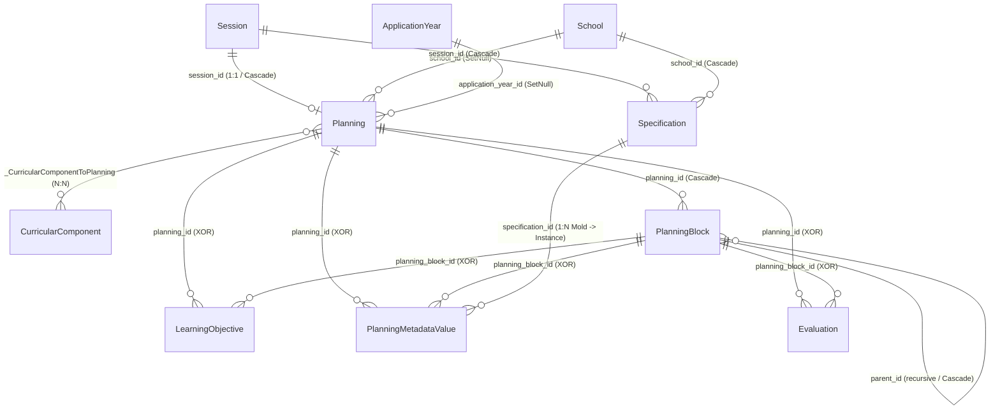
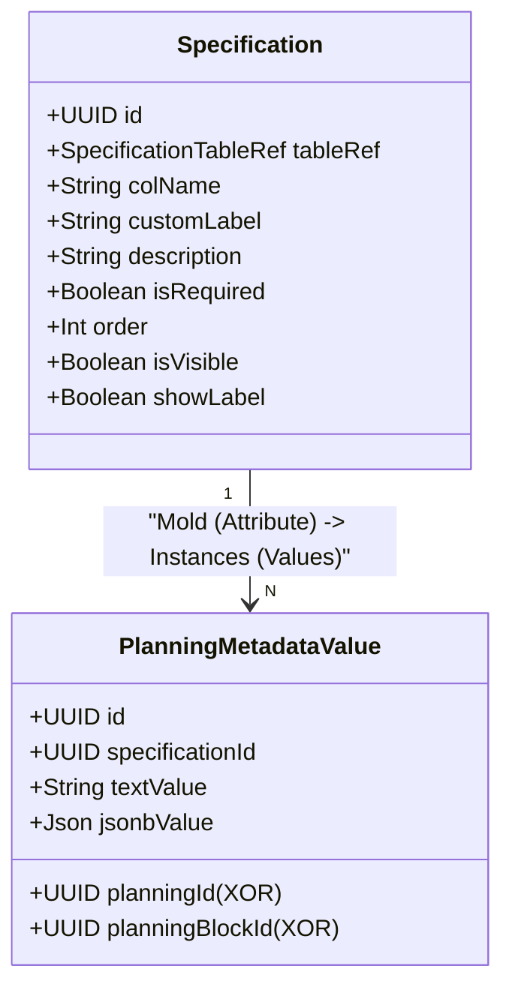

# 01 — Relational Data Modeling, Lean Core & EAV Pattern

This document details the relational PostgreSQL database schema for Lesson Planning, the lean core models (`Planning` and `PlanningBlock`), and the dynamic adaptation engine (Entity-Attribute-Value via `Specification` and `PlanningMetadataValue`).

---

## 🏛️ Entity-Relationship Diagram (ERD)



---

## 1. The Macro Header (`Planning`)

The `Planning` model (`plannings`) anchors the highest level of granularity for the active session. It concentrates institutional and pedagogical definitions shared across the entire academic cycle.

### Fields and Schema Mapping

| Field | Type / Modifiers | Pedagogical Role & Orchestration Rule |
| :--- | :--- | :--- |
| `id` | `UUID @id @default(uuid())` | Unique planning identifier. |
| `sessionId` | `UUID @map("session_id")` | 1:1 relation to the active chat session (`Session`), with cascading deletion (`onDelete: Cascade`). |
| `schoolId` | `UUID? @map("school_id")` | Associated educational institution (`School`). Created dynamically if the teacher references a new school. |
| `applicationYearId` | `UUID? @map("application_year_id")` | Normalizes the target grade, age bracket, or educational stage (`ApplicationYear`), restricting eligible BNCC skills. |
| `startAt` | `DateTime? @map("start_at")` | Overall cycle start date (inferred by the AI or specified by the teacher). |
| `endAt` | `DateTime? @map("end_at")` | Overall cycle end date. |
| `granularity` | `Enum PlanningGranularity?` | Macro planning granularity: `ANNUAL`, `SEMESTER`, `TRIMESTER`, `BIMONTHLY`, `MONTHLY`, `WEEKLY`, `DAILY`, `CUSTOM`. |

### Macro Header Relations
- **`curricularComponents` (N:N Relation):** Connects subjects covered by the plan (e.g. Portuguese, Mathematics, History).
- **`learningObjectives` (Macro Level):** Broad BNCC skills cultivated continuously throughout the entire cycle.
- **`metadataValues`:** Custom header-level metadata instances (e.g. *Cross-Cutting Themes*, *Faith-Based Integration*, *Pastoral Didactic Transposition*).
- **`evaluations`:** Cycle-closing summative evaluations or broad qualitative assessments (e.g. Early Childhood developmental reports).

---

## 2. Recursive Block Layer (`PlanningBlock`)

The `PlanningBlock` model (`planning_blocks`) is the universal primitive for representing any subdivision of time, curriculum unit, or depth beneath the `Planning` header.

### Self-Referencing Hierarchy (`parentId`)
The `parentId` field references another `PlanningBlock` recursively:
- Enables arbitrary depth hierarchies such as:
  - `TRIMESTER` $\rightarrow$ `MONTHLY` (Jan, Feb, Mar) $\rightarrow$ `WEEKLY` (Weeks 1..4) $\rightarrow$ `DAILY` (Days 1..5).
  - `SEMESTER` $\rightarrow$ `MONTHLY` $\rightarrow$ `WEEKLY`.
  - `WEEKLY` $\rightarrow$ `DAILY`.

### Dual Date Pattern (`startAt` vs `endAt`)
Supports both primary scheduling patterns observed across Brazilian schools:
1. **Interval Blocks (Macro / Multi-day Units):**
   - Both dates populated (`startAt != null` and `endAt != null`). E.g.: Weekly block from `09/01` to `09/08`.
2. **Daily Blocks (Micro / Single Lessons):**
   - Only `startAt` populated (`startAt != null`) and **`endAt = null`** (standard practice across Early Childhood and Elementary Education).

### Sequential Ordering (`order`)
The `order: Int @default(0)` field guarantees deterministic ordering between sibling blocks (sharing the same `parentId`), essential for:
- Multiple lessons occurring on the same date (e.g. Lesson 1, Lesson 2).
- Non-dated lesson sequences (e.g. "Lesson 1 — Introduction", "Lesson 2 — Guided Practice").

### Fixed Methodology Column & Anti-Duplication Invariant
The `metodologia: Text?` field is kept as a dedicated physical column in `planning_blocks` because it was present in 100% of validated pedagogical models under slight naming variations (*"Didactic Sequence"*, *"Methodology (P, O, A & Av)"*, *"Lesson Development"*).

> [!IMPORTANT]
> **Anti-Duplication Invariant for Methodology:**
> When the AI emits a patch updating methodology (via `FILL_METADATA`, `UPSERT_PLANNING`, or `UPDATE_BLOCK_BY_DATE`), the value is written **strictly to the physical column `planning_blocks.metodologia`**. It must generate **zero rows** in `planning_metadata_values`. Use cases actively clean up any residual or duplicate EAV records (`deleteMany where specificationId = spec.id and planningBlockId = blockId`) to guarantee a single relational source of truth and prevent conflicting states in the frontend.

### Leaf Node Priority in Hierarchical Trees
In multi-level architectures (e.g. `TRIMESTER` $\rightarrow$ `MONTHLY` $\rightarrow$ `WEEKLY`), sibling blocks across different months frequently share the same ordinal `order: 1` or overlapping date intervals. To prevent mutations intended for a specific week from accidentally overwriting an ancestor month or trimester block:
- **Leaf Node Resolution Precedence:** Resolvers prioritize leaf blocks (`children.length === 0`).
- **Target Resolution Hierarchy:** `blockId` (exact) > `parentId` + `order` (local month scope) > `granularity` + `date` (temporal window within layer). Ancestor blocks are only targeted when `granularity` is explicitly specified.

---

## 3. The EAV Adaptation Engine (`Specification` & `PlanningMetadataValue`)

To allow every school district or private institution to customize labels and dynamic columns without modifying the underlying PostgreSQL schema, the system applies the **Entity-Attribute-Value (EAV)** pattern.



### A. Specifications Table (`Specification`)
Defines the contract and definition mold for a field within the active session:
- **`tableRef` (`SpecificationTableRef`):** Scope of action:
  - `PLANNING`: Macro header metadata.
  - `PLANNING_BLOCK`: Lesson / block metadata.
- **`isRequired` (`Boolean @default(false)`):** Marks whether this field is mandatory for the school/session. When `true`, triggers mandatory AI slot-filling.
- **`order` (`Int @default(0)`):** Universal numeric ordering sequence for header elements and table columns.
- **`isVisible` (`Boolean @default(true)`):** Controls visibility and omission of sections or columns without deleting underlying data.
- **`showLabel` (`Boolean @default(true)`):** Controls whether the top field label is rendered or omitted (rendering direct value only).
- **Dual Semantics of `colName`:**
  1. *Native Column Override (Anti-Duplication Invariant):* When `colName` matches a fixed native column or relation (e.g. `metodologia`, `curricularComponents`, `evaluations`, `learningObjectives`), the specification acts strictly as a presentation mold (`customLabel`, `order`, `isVisible`, `showLabel`). **Generates 0 rows in `PlanningMetadataValue`**, persisting data directly into the physical column or relation.
     - *Anti-Duplication Rule:* If the teacher asks to rename "Componente" to "Disciplina" and change the subject to "Português", the system updates `Planning.curricularComponents` directly (via `curricularComponentNames: ["Língua Portuguesa"]`) and updates the specification with `colName: "curricularComponents"`, `customLabel: "Disciplina"`. It **never creates an ad-hoc EAV specification `colName: "disciplina"` with separate `PlanningMetadataValue` rows**, which would create duplicate cards on the UI.
  2. *Custom Dynamic Field:* When `colName` does not exist on the fixed table (e.g. `recursos_didaticos`, `aplicacao_crista`), the specification generates **1 or more rows in `PlanningMetadataValue`**.
- **`description`:** Pedagogical instructions on how the field should be authored (fed directly into AI system prompts).

### B. Metadata Value Persistence (`PlanningMetadataValue`)
Stores the actual content authored by the teacher:
- **Hybrid Storage Strategy:**
  - `textValue` (`Text`): Long narratives, essays, and descriptive text (optimized for PostgreSQL full-text search and `ILIKE`).
  - `jsonbValue` (`JSONB`): Checklists, multiple selections, and structured arrays without manual string serialization.

---

## 4. Polymorphic Integrity Constraints (XOR)

To prevent duplicate references or orphan associations, polymorphic child tables enforce an exclusive OR (**XOR**) check constraint in PostgreSQL:

```sql
-- 1. XOR check on learning_objectives (BNCC skills):
ALTER TABLE learning_objectives
ADD CONSTRAINT chk_learning_objective_xor_parent
CHECK (
  (planning_id IS NOT NULL AND planning_block_id IS NULL) OR
  (planning_id IS NULL AND planning_block_id IS NOT NULL)
);

-- 2. XOR check on planning_metadata_values (EAV instances):
ALTER TABLE planning_metadata_values
ADD CONSTRAINT chk_planning_metadata_value_xor_parent
CHECK (
  (planning_id IS NOT NULL AND planning_block_id IS NULL) OR
  (planning_id IS NULL AND planning_block_id IS NOT NULL)
);

-- 3. XOR check on evaluations (Assessment instruments):
ALTER TABLE evaluations
ADD CONSTRAINT chk_evaluation_xor_parent
CHECK (
  (planning_id IS NOT NULL AND planning_block_id IS NULL) OR
  (planning_id IS NULL AND planning_block_id IS NOT NULL)
);
```

Persistence use cases and AI patch handlers must always populate exactly one of the foreign keys (`planning_id` or `planning_block_id`), never both and never neither.

> [!WARNING]
> **XOR Constraint Rejection Guard:**
> When persisting block-level custom metadata (`tableRef: "PLANNING_BLOCK"`), if the target block cannot be unambiguously resolved from the tree, the operation **must abort the individual value insertion** and log a warning rather than inserting a `null` `planning_block_id`. Emitting `planning_block_id: null` when `planning_id` is also `null` immediately triggers a PostgreSQL check constraint violation (`chk_planning_metadata_value_xor_parent`), causing transaction rollback.

### Macro BNCC Isolation via XOR (`bnccCodes: []`)
Because `learning_objectives` enforces the XOR constraint between `planning_id` and `planning_block_id`, macro cycle objectives and micro lesson objectives are strictly partitioned at the database level:
- When a plan reaches daily granularity, duplicating all aggregated BNCC skills in the macro header causes visual clutter.
- Explicitly passing `bnccCodes: []` in `UPSERT_PLANNING` triggers an atomic deletion scoped strictly to the macro header:
  ```typescript
  await prisma.learningObjective.deleteMany({
    where: { planningId: planning.id },
  });
  ```
- Daily lesson skills (`planning_block_id IS NOT NULL`) remain 100% untouched.
- Alternatively, visual omission without deleting database records can be achieved by updating the specification with `isVisible: false`.

---

## 5. Audit Trail & Chat History Hygiene (`Conversation.commands`)

To ensure clean chat history without sacrificing structured auditability, the `Conversation` table stores visual and machine-actionable outputs separately:

```prisma
model Conversation {
  id          String           @id @default(uuid())
  sessionId   String           @map("session_id")
  session     Session          @relation(fields: [sessionId], references: [id], onDelete: Cascade)
  text        String           @db.Text
  type        ConversationType
  commands    Json?            @map("commands") // Structured AI patch execution payload
  interrupted Boolean          @default(false)
  createdAt   DateTime         @default(now()) @map("created_at")

  @@map("conversations")
}
```

### Architectural Rationale:
1. **Context Window Hygiene:** `Conversation.text` stores strictly sanitized, human-readable Markdown. When previous messages are compiled for subsequent LLM turns, historical JSON blocks are completely excluded, preserving context window budget and respecting the Database Snapshot as the single source of truth.
2. **Auditability & Traceability:** `Conversation.commands` records the parsed and validated patch payload executed by the AI, enabling retroactive inspection, debugging, and telemetry on planning mutations.

---

## 6. Resolução Determinística de Catálogo Relacional & Sincronização Atômica de Pivot

### A. Anti-Pattern de "Fuzzy Matching Frouxo" em Entidades Catalogadas
Tentativas de resolver chaves estrangeiras relacionais (`ApplicationYear` e `CurricularComponent`) utilizando `String.includes()` ou buscas heurísticas frouxas provocam colisões silenciosas graves:
- **Colisão de Segmentos por Numerais Ordinais:** "3º Ano do EM" era capturado pelo primeiro registro contendo "3º" (`3º ano do Ensino Fundamental I`), ignorando o Ensino Médio.
- **Colisão de Domínio entre Componentes:** "Língua Portuguesa" caía em "Escuta, fala, pensamento e imaginação" por agrupamentos frouxos (`|| lowerC.includes('escuta')`).
- **Falsos Positivos de Meses Infantis:** Expressões da Educação Infantil como "1 ano e 7 meses" colidiam com "7º ano".

### B. Hierarquia de Resolução Determinística (`academic-catalog-matcher.ts`)
1. **Match Exato Normalizado Prioritário:** Comparação canônica sem acentos e em minúsculas contra o catálogo oficial.
2. **Desambiguação Categórica por Etapa (`EducationStage`):** Marcadores como `"EM"`, `"Médio"` restringem a busca exclusivamente à etapa `MEDIO`; marcadores de `"Fundamental I"` ou `"Fundamental II"` separam o 1º-5º ano do 6º-9º ano; marcadores infantis (`"bebês"`, `"crianças bem pequenas"`, `"meses"`, `"creche"`) são resolvidos na etapa `INFANTIL` antes de qualquer avaliação de numerais ordinais.
3. **Isolamento Estrito de Domínio Curricular:** Componentes curriculares da Educação Básica e Campos de Experiência da Educação Infantil são domínios disjuntos e nunca compartilham rotas de fallback.

### C. Sincronização Atômica de Transições de Cabeçalho (Pivot)
Ao alterar a etapa (`yearChanged`) ou componentes de um planejamento existente:
- As habilidades BNCC macro (`LearningObjective`) atreladas à etapa anterior que não pertençam aos novos `bnccCodes` são automaticamente purgadas.
- Os componentes curriculares são sincronizados via `set: componentIds`, prevenindo que disciplinas ou habilidades incompatíveis de um segmento anterior sobrevivam na base após um redirecionamento pedagógico.
