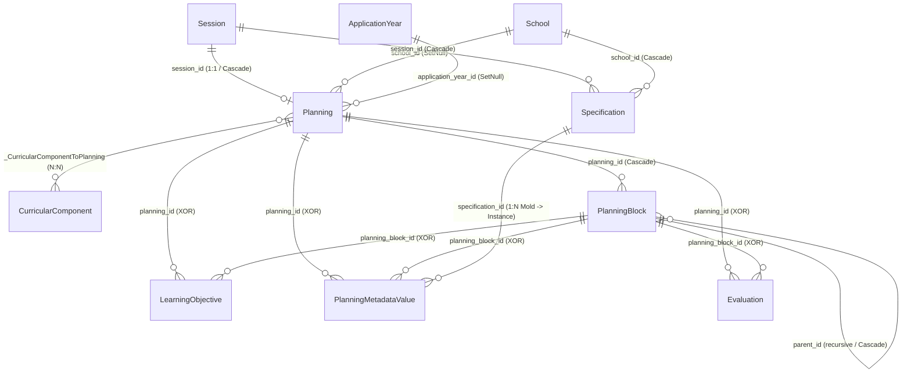
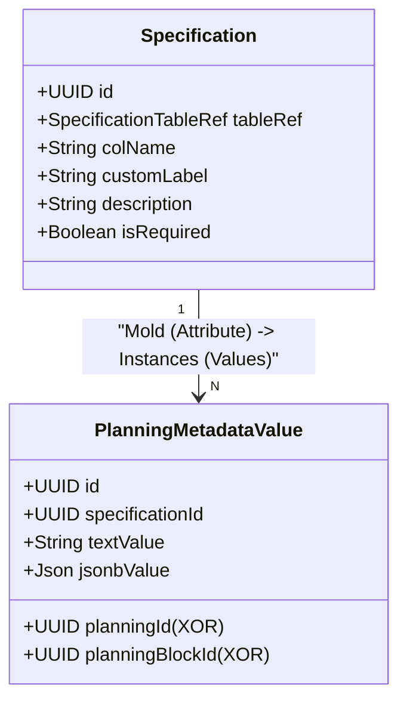

# 01 — Relational Data Modeling, Lean Core & EAV Pattern

This document details the relational PostgreSQL database schema for Lesson Planning, the lean core models (`Planning` and `PlanningBlock`), and the dynamic adaptation engine (Entity-Attribute-Value via `Specification` and `PlanningMetadataValue`).

---

## 🏛️ Entity-Relationship Diagram (ERD)



---

## 1. The Macro Header (`Planning`)

The `Planning` model (`plannings`) anchors the highest level of granularity for the active session. It concentrates institutional and pedagogical definitions shared across the entire academic cycle.

### Fields and Schema Mapping

| Field | Type / Modifiers | Pedagogical Role & Orchestration Rule |
| :--- | :--- | :--- |
| `id` | `UUID @id @default(uuid())` | Unique planning identifier. |
| `sessionId` | `UUID @map("session_id")` | 1:1 relation to the active chat session (`Session`), with cascading deletion (`onDelete: Cascade`). |
| `schoolId` | `UUID? @map("school_id")` | Associated educational institution (`School`). Created dynamically if the teacher references a new school. |
| `applicationYearId` | `UUID? @map("application_year_id")` | Normalizes the target grade, age bracket, or educational stage (`ApplicationYear`), restricting eligible BNCC skills. |
| `startAt` | `DateTime? @map("start_at")` | Overall cycle start date (inferred by the AI or specified by the teacher). |
| `endAt` | `DateTime? @map("end_at")` | Overall cycle end date. |
| `granularity` | `Enum PlanningGranularity?` | Macro planning granularity: `ANNUAL`, `SEMESTER`, `TRIMESTER`, `BIMONTHLY`, `MONTHLY`, `WEEKLY`, `DAILY`, `CUSTOM`. **Always reflects the highest level of granularity of the entire plan** (the macro scope container). |

> [!IMPORTANT]
> **Macro Granularity Principle (`Planning.granularity`):**
> The `Planning` model represents the outermost scope container of the planning. The highest granularity is **always** assigned to `Planning`.
> - If the teacher requests a **Trimester** to be divided into Monthly and then Weekly blocks:
>   `Planning` (`TRIMESTER`) $\rightarrow$ `PlanningBlock` (`MONTHLY`) $\rightarrow$ `PlanningBlock` (`WEEKLY`, with `parentId` referencing the month).
> - If the teacher requests a **1-week** plan composed of 5 daily lessons/experiences:
>   `Planning` (`WEEKLY`) $\rightarrow$ `PlanningBlock` (`DAILY`, with `order` or `startAt`).
> - A `Planning.granularity` of `DAILY` is reserved **exclusively** for single, standalone 1-day lesson plans. When a plan spans multiple days or 1 full week, the macro `Planning` granularity is **`WEEKLY`**, never `DAILY`.

### Macro Header Relations
- **`curricularComponents` (N:N Relation):** Connects subjects covered by the plan (e.g. Portuguese, Mathematics, History).
- **`learningObjectives` (Macro Level):** Broad BNCC skills cultivated continuously throughout the entire cycle.
- **`metadataValues`:** Custom header-level metadata instances (e.g. *Cross-Cutting Themes*, *Faith-Based Integration*, *Pastoral Didactic Transposition*).
- **`evaluations`:** Cycle-closing summative evaluations or broad qualitative assessments (e.g. Early Childhood developmental reports).

---

## 2. Recursive Block Layer (`PlanningBlock`)

The `PlanningBlock` model (`planning_blocks`) is the universal primitive for representing any subdivision of time, curriculum unit, or depth beneath the `Planning` header.

### Self-Referencing Hierarchy (`parentId`)
The `parentId` field references another `PlanningBlock` recursively:
- Enables arbitrary depth hierarchies such as:
  - `TRIMESTER` $\rightarrow$ `MONTHLY` (Jan, Feb, Mar) $\rightarrow$ `WEEKLY` (Weeks 1..4) $\rightarrow$ `DAILY` (Days 1..5).
  - `SEMESTER` $\rightarrow$ `MONTHLY` $\rightarrow$ `WEEKLY`.
  - `WEEKLY` $\rightarrow$ `DAILY`.

### Dual Date Pattern (`startAt` vs `endAt`)
Supports both primary scheduling patterns observed across Brazilian schools:
1. **Interval Blocks (Macro / Multi-day Units):**
   - Both dates populated (`startAt != null` and `endAt != null`). E.g.: Weekly block from `09/01` to `09/08`.
2. **Daily Blocks (Micro / Single Lessons):**
   - Only `startAt` populated (`startAt != null`) and **`endAt = null`** (standard practice across Early Childhood and Elementary Education).

### Sequential Ordering (`order`)
The `order: Int @default(0)` field guarantees deterministic ordering between sibling blocks (sharing the same `parentId`), essential for:
- Multiple lessons occurring on the same date (e.g. Lesson 1, Lesson 2).
- Non-dated lesson sequences (e.g. "Lesson 1 — Introduction", "Lesson 2 — Guided Practice").

### Fixed Methodology Column
The `metodologia: Text?` field is kept as a dedicated physical column in `planning_blocks` because it was present in 100% of validated pedagogical models under slight naming variations (*"Didactic Sequence"*, *"Active Methodology"*, *"Methodology (P, O, A & Av)"*, *"Lesson Development"*, *"Didactic Practice"*, *"Step-by-Step Experience"*).

> [!WARNING]
> **Anti-Lumping Invariant (`metodologia` vs `Specification`):**
> The physical `metodologia` column stores **strictly the lesson's active methodology / didactic sequence / classroom development** (or pedagogically close concepts like welcoming circle, sensorial exploration, quiet transition).
> - When the teacher specifies an authoring structure with multiple discrete columns (e.g. *Date/Topic, Content, Learning Objectives, Didactic Sequence*):
>   1. The `metodologia` column receives **only the didactic sequence**.
>   2. **It is strictly forbidden to lump multiple columns together into `metodologia`** (e.g. bundling `"Content: ... Objectives: ... Sequence: ..."` into a single text blob).
>   3. Each additional column requested (such as *"Content"* or *"Teaching Resources"*) must be modeled cleanly as a `Specification` (`tableRef: "PLANNING_BLOCK"`, `customLabel: "Conteúdo"`), persisting its discrete values into `PlanningMetadataValue` for each respective daily block.

---

## 3. The EAV Adaptation Engine (`Specification` & `PlanningMetadataValue`)

To allow every school district or private institution to customize labels and dynamic columns without modifying the underlying PostgreSQL schema, the system applies the **Entity-Attribute-Value (EAV)** pattern.



### A. Specifications Table (`Specification`)
Defines the contract and definition mold for a field within the active session:
- **`tableRef` (`SpecificationTableRef`):** Scope of action:
  - **`PLANNING` (Macro / Cycle Scope):** Used whenever the metadata applies to the cycle or week as a whole (e.g. *Weekly Christian Application*, *General Weekly Routine*, *Trimester Objectives*).
  - **`PLANNING_BLOCK` (Micro / Lesson Scope):** Used whenever the metadata varies per individual lesson or day (e.g. *Daily Content*, *Lesson Resources*, *Homework*).
- **`isRequired` (`Boolean @default(false)`):** Marks whether this field is mandatory for the school/session. When `true`, triggers mandatory AI slot-filling.
- **Dual Semantics of `colName`:**
  1. *Native Column Override:* When `colName` matches a fixed native column (e.g. `metodologia`), the specification only changes the display label (`customLabel = "Sequência Didática"`). **Generates 0 rows in `PlanningMetadataValue`**, persisting data directly into the physical column.
  2. *Custom Dynamic Field:* When `colName` does not exist on the fixed table (e.g. `recursos_didaticos`, `aplicacao_crista`), the specification generates **1 or more rows in `PlanningMetadataValue`**.
- **`description`:** Pedagogical instructions on how the field should be authored (fed directly into AI system prompts).

> [!IMPORTANT]
> **Zero Orphan Specifications Invariant:**
> A `Specification` mold must **never** exist in the database without populated values in `PlanningMetadataValue` (unless waiting for teacher input during active slot-filling). When a custom column is registered, the AI must provide its content immediately (via `initialValue` or `metadataValues`) or explicitly prompt the teacher for the missing data. Unused or abandoned specifications must be deleted to prevent orphaned molds.

### B. Metadata Value Persistence (`PlanningMetadataValue`)
Stores the actual content authored by the teacher:
- **Hybrid Storage Strategy:**
  - `textValue` (`Text`): Long narratives, essays, and descriptive text (optimized for PostgreSQL full-text search and `ILIKE`).
  - `jsonbValue` (`JSONB`): Checklists, multiple selections, and structured arrays without manual string serialization.

---

## 4. Polymorphic Integrity Constraints (XOR)

To prevent duplicate references or orphan associations, polymorphic child tables enforce an exclusive OR (**XOR**) check constraint in PostgreSQL:

```sql
-- 1. XOR check on learning_objectives (BNCC skills):
ALTER TABLE learning_objectives
ADD CONSTRAINT chk_learning_objective_xor_parent
CHECK (
  (planning_id IS NOT NULL AND planning_block_id IS NULL) OR
  (planning_id IS NULL AND planning_block_id IS NOT NULL)
);

-- 2. XOR check on planning_metadata_values (EAV instances):
ALTER TABLE planning_metadata_values
ADD CONSTRAINT chk_planning_metadata_value_xor_parent
CHECK (
  (planning_id IS NOT NULL AND planning_block_id IS NULL) OR
  (planning_id IS NULL AND planning_block_id IS NOT NULL)
);

-- 3. XOR check on evaluations (Assessment instruments):
ALTER TABLE evaluations
ADD CONSTRAINT chk_evaluation_xor_parent
CHECK (
  (planning_id IS NOT NULL AND planning_block_id IS NULL) OR
  (planning_id IS NULL AND planning_block_id IS NOT NULL)
);
```

Persistence use cases and AI patch handlers must always populate exactly one of the foreign keys (`planning_id` or `planning_block_id`), never both and never neither.

---

## 5. Audit Trail & Chat History Hygiene (`Conversation.commands`)

To ensure clean chat history without sacrificing structured auditability, the `Conversation` table stores visual and machine-actionable outputs separately:

```prisma
model Conversation {
  id          String           @id @default(uuid())
  sessionId   String           @map("session_id")
  session     Session          @relation(fields: [sessionId], references: [id], onDelete: Cascade)
  text        String           @db.Text
  type        ConversationType
  commands    Json?            @map("commands") // Structured AI patch execution payload
  interrupted Boolean          @default(false)
  createdAt   DateTime         @default(now()) @map("created_at")

  @@map("conversations")
}
```

### Architectural Rationale:
1. **Context Window Hygiene:** `Conversation.text` stores strictly sanitized, human-readable Markdown. When previous messages are compiled for subsequent LLM turns, historical JSON blocks are completely excluded, preserving context window budget and respecting the Database Snapshot as the single source of truth.
2. **Auditability & Traceability:** `Conversation.commands` records the parsed and validated patch payload executed by the AI, enabling retroactive inspection, debugging, and telemetry on planning mutations.
