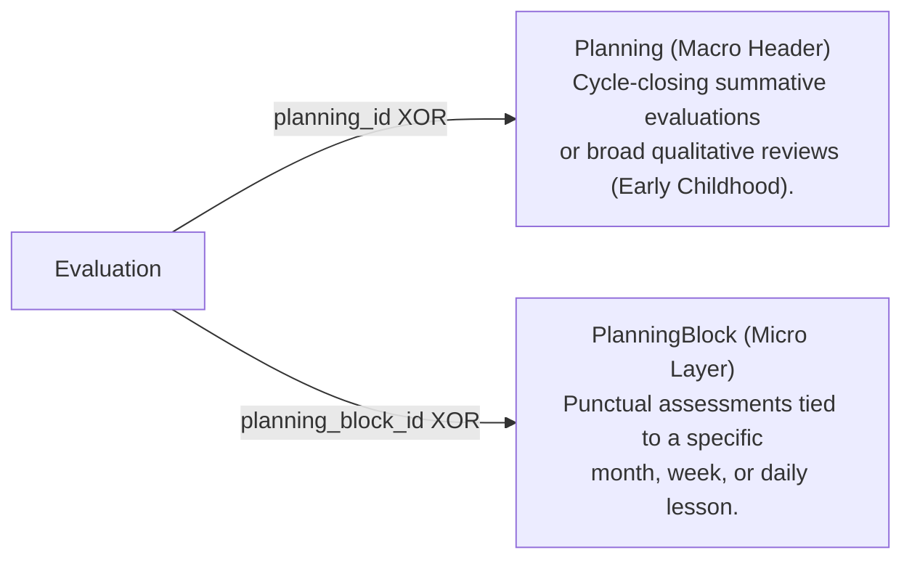

# 03 — Brazilian Basic Education Evaluation System

This document outlines the business rules, relational architecture, and pedagogical nuances of the evaluation system (`Evaluation`) in the Teachy platform.

---

## 1. Polymorphic Binding & Scope (Constraint XOR)

The `Evaluation` model (`evaluations`) is exclusively bound either to a `Planning` (macro header) or to a `PlanningBlock` (specific period or lesson):

### Scope Examples:
- **Bound to `Planning` (`planning_id`):**
  - Qualitative assessments in Early Childhood (developmental and social interaction descriptive reports).
  - Continuous Processual Assessment (`AP`) throughout High School.
  - Interdisciplinary trimester projects (`AI` / `PBL`).
- **Bound to `PlanningBlock` (`planning_block_id`):**
  - Partial written exam scheduled for the 3rd week of October.
  - Notebook check on April 15th.
  - Oral presentation in Friday's double-period block.

---

## 2. Strict Temporal Hierarchy

The model supports three distinct timestamp configurations (`start_at` and `end_at`):
1. **Assessment Window:** Both dates populated (e.g. `09/28` to `10/02` for exam week).
2. **Single Assessment Date:** Only `start_at` populated and **`end_at = null`** (e.g. unit test on `10/07`).
3. **Continuous / Longitudinal Assessment:** Both null (`start_at = null` and `end_at = null`), indicating ongoing formative observation across the parent entity's entire duration.

> [!WARNING]
> **Temporal Containment Invariant:** Because an evaluation belongs to the scope of a `Planning` or `PlanningBlock`, its dates **must reside strictly within the parent window** (`parent.start_at <= eval.start_at` and `eval.end_at <= parent.end_at`).

---

## 3. Practical Guideline: `instrumentType` vs `name`

To ensure institutional standardization while preserving teacher authoring flexibility:
- **`instrumentType` (Category / Acronym):** Standardized institutional categorization.
- **`name` (Specific Title):** Concrete activity/delivery designation.

| `instrumentType` (Category / Acronym) | `name` (Specific Delivery Title) |
| :--- | :--- |
| **Written Exam / Test** (`PAR`, `GLB`, `P1`, `AV1`) | *Open-book Partial Assessment*, *Algebra Bimonthly Exam*, *Globalizing Exam* |
| **Simulated Exam** (`SI`) | *ENEM Simulation — Languages & Essay*, *Diagnostic Entrance Exam* |
| **Assignment / Exercise** | *Standardized Argumentative Essay*, *Chapter 4 Exercise List*, *Paired Research Task* |
| **Project / Interdisciplinary** (`AI`, `PBL`) | *Brotherhood Campaign Project*, *Science Fair Showcase*, *Father's Day Card Creation* |
| **Seminar / Presentation** | *Industrial Revolution Group Seminar*, *Moderated AI Ethics Debate* |
| **Continuous / Processual** (`AP`, Qualitative) | *Classroom Participation & Notes*, *Socratic Seminar Engagement*, *Quarterly Portfolio* |
| **Practical / Laboratory** | *Chemistry Lab Report*, *Motor Skills Circuit*, *Physical Education Practical Evaluation* |
| **Recovery / Parallel Remediation** | *3rd Trimester Parallel Remediation*, *Guided Essay Rewrite* |
| **Diagnostic / Formative** | *Reading Fluency Probe*, *Remedial Review Task* |
| **Observation / Anecdotal** (Early Childhood) | *School Adaptation Report*, *Oral Expression & Social Interaction Log* |

---

## 4. `description` vs `criteria`

Separating descriptive and evaluative dimensions guarantees pedagogical clarity:
- **`description` (`Text`):** Defines **what the activity consists of** (e.g. *"Sustainable architectural model construction using recyclable materials in teams of 4"*).
- **`criteria` (`Text`):** Defines **how the student is assessed** (e.g. *"Rubric: 1. Mastery of sustainability concepts (4.0 pts); 2. Craftsmanship and finish (3.0 pts); 3. Team cooperation and presentation clarity (3.0 pts)"*).

---

## 5. Grading Variations Across Brazilian Basic Education

The `grade: Decimal? @db.Decimal(5, 2)` column accommodates all standard grading systems:

1. **0 to 10 Scale (Most Common Private/Public Standard):**
   - Whole or fractional points (e.g. `1.0`, `3.5`, `4.0`, totaling `10.0` for the grading period).
2. **0 to 100 Scale (State and Municipal Networks):**
   - Prevalent across states like São Paulo and Minas Gerais, or networks utilizing 25 points per bimester (`25.0 + 25.0 + 25.0 + 25.0 = 100.0` across the academic year).
3. **Weighted Averages:**
   - Instruments graded on a base 0-10 scale carrying distinct weights (e.g. Final Exam weight 2, Assignments weight 1). Weight multipliers are captured via `Specification`.
4. **Ungraded / Purely Formative or Qualitative:**
   - Early Childhood education, observational rubrics, and diagnostic probes. The `grade` field remains `null`, with the full evaluative focus placed on `criteria` and `description`.
5. **Bonus / Extra Credit:**
   - Optional challenge tasks adding `0.5` or `1.0` bonus point to the composite grade.
