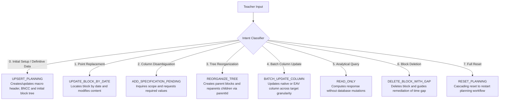

# 04 — Conversational Intent Catalog & Prisma Operations

This document catalogs teacher conversational intents, their dialogue workflows, and corresponding PostgreSQL mutations via Prisma.

---

> [!TIP]
> **Communication Guideline (Teacher-to-Teacher Tone):**
> Across all intents below, AI chat responses remain concise, supportive, and collegial (avoiding redundant full-table text walls). Updated blocks, dates, and specifications reflect immediately in the **Living Draft** side panel.

## 🗺️ Intent Matrix Overview



---

## 0. Initial Setup & Definitive Parameters (`UPSERT_PLANNING`)
* **Teacher Command:** *"I want to create a monthly math plan for the 3rd grade covering BNCC skills EF03MA01 and EF03MA02"*.
* **AI Behavior:**
  - Detects consolidated planning parameters (subject, grade level, cycle granularity, dates, and BNCC objectives).
  - Emits the `UPSERT_PLANNING` payload containing header fields, connected curricular components, macro `learningObjectives`, and initial skeleton `planning_blocks`.
* **Prisma Operation:**
  ```typescript
  await prisma.planning.upsert({
    where: { sessionId },
    create: {
      sessionId,
      granularity: 'MONTHLY',
      curricularComponents: { connect: [{ id: mathComponentId }] },
      applicationYearId: thirdGradeId,
      blocks: {
        create: initialBlocksData,
      },
      learningObjectives: {
        create: bnccSkillIds.map((skillId) => ({ bnccSkillId: skillId })),
      },
    },
    update: {
      granularity: 'MONTHLY',
      applicationYearId: thirdGradeId,
    },
  });
  ```

---

## 1. Point Replacement by Date (`UPDATE_BLOCK_BY_DATE`)
* **Teacher Command:** *"Switch the lesson on August 6th to the Father's Day craft activity"*.
* **AI Behavior:**
  - Locates the `PlanningBlock` where `start_at` matches August 6th.
  - Updates the `metodologia` field and lesson description to reflect the Father's Day craft project.
  - Associates relevant BNCC skills if appropriate.
* **Prisma Operation:**
  ```typescript
  await prisma.planningBlock.updateMany({
    where: {
      planning: { sessionId },
      startAt: { gte: new Date('2026-08-06T00:00:00Z'), lte: new Date('2026-08-06T23:59:59Z') },
    },
    data: { metodologia: 'Special Father’s Day craft and oral storytelling activity...' },
  });
  ```

---

## 2. Column Addition with Disambiguation (`ADD_SPECIFICATION_PENDING`)
* **Teacher Command:** *"Add a column for teaching resources"*.
* **AI Behavior:**
  - Identifies that "teaching resources" is not a native column and that the current plan contains multiple tiers (e.g. Trimester $\rightarrow$ Monthly $\rightarrow$ Daily).
  - Clarifies scope: *"Would you like teaching resources for the entire trimester (header), for each month (Jan, Feb, Mar), or for each daily lesson?"*.
  - Upon answer (*"Just for the months"*), creates the `Specification` (`table_ref = PLANNING_BLOCK`, `isRequired = true`).
  - **Mandatory Slot-Filling:** Promptly follows up: *"What resources will you be using in January, February, and March?"*.
  - Records answers in `PlanningMetadataValue`.

---

## 3. Recursive Tree Reorganization (`REORGANIZE_TREE`)
* **Teacher Command:** *"Group the lessons by week, but keep every single day detailed"*.
* **AI Behavior:**
  - Creates new parent `PlanningBlock` records with `granularity = WEEKLY` (e.g. Week 1, Week 2).
  - Reassigns the `parentId` of existing daily blocks (`granularity = DAILY`) to their matching weekly parent block based on date windows.
* **Prisma Operation:**
  ```typescript
  // 1. Create parent weekly block
  const weekBlock = await prisma.planningBlock.create({
    data: {
      planningId,
      granularity: 'WEEKLY',
      startAt: weekStart,
      endAt: weekEnd,
      order: 1,
    },
  });
  // 2. Re-parent matching daily child blocks
  await prisma.planningBlock.updateMany({
    where: {
      planningId,
      granularity: 'DAILY',
      startAt: { gte: weekStart, lte: weekEnd },
    },
    data: { parentId: weekBlock.id },
  });
  ```

---

## 4. Batch Column Update & Compression (`BATCH_UPDATE_COLUMN`)
* **Teacher Command:** *"Make the didactic sequences more concise across all weeks"* or *"Shorten the teaching resources description in the weekly blocks"*.
* **AI Behavior:**
  - Identifies target granularity (e.g. `WEEKLY`) and target column.
  - Distinguishes whether the target is the physical native `metodologia` column in `planning_blocks` or an EAV dynamic column in `planning_metadata_values`.
  - Rewrites/updates target texts across all matching blocks in batch.
* **Prisma Operation:**
  ```typescript
  // Native column batch update:
  await prisma.planningBlock.updateMany({
    where: { planningId, granularity: 'WEEKLY' },
    data: { metodologia: 'Concise synthesized didactic sequence...' },
  });

  // Or EAV dynamic column batch update:
  await prisma.planningMetadataValue.updateMany({
    where: {
      specificationId: customSpecId,
      planningBlock: { planningId, granularity: 'WEEKLY' },
    },
    data: { textValue: 'Updated concise resources...' },
  });
  ```

---

## 5. Read-Only Analytical Query (`READ_ONLY`)
* **Teacher Command:** *"How many class periods are left before the midterm exam?"*.
* **AI Behavior:**
  - Queries `PlanningBlock` records and finds the `Evaluation` marked as the midterm exam.
  - Computes the count of instructional blocks prior to the exam timestamp.
  - **Zero Database Mutations:** Replies analytically without executing `create`, `update`, or `delete` queries.

---

## 6. Block Deletion with Gap Management (`DELETE_BLOCK_WITH_GAP`)
* **Teacher Command:** *"Delete the week 2 block"*.
* **AI Behavior:**
  - Deletes the Week 2 `PlanningBlock` (and child rows in cascade).
  - Detects the unmapped gap between Week 1 and Week 3.
  - Inquires: *"I removed Week 2. Would you like to introduce a revised topic for that window or adjust the schedule forward?"*.

---

## 7. Full Planning Reset (`RESET_PLANNING`)
* **Teacher Command:** *"I don't like how this turned out; let's start over from scratch"*.
* **AI Behavior:**
  - Executes cascading deletion of the session's planning and specifications:
    ```typescript
    await prisma.planning.deleteMany({ where: { sessionId } });
    await prisma.specification.deleteMany({ where: { sessionId } });
    ```
  - Resets the dialogue state to the initial discovery phase.
