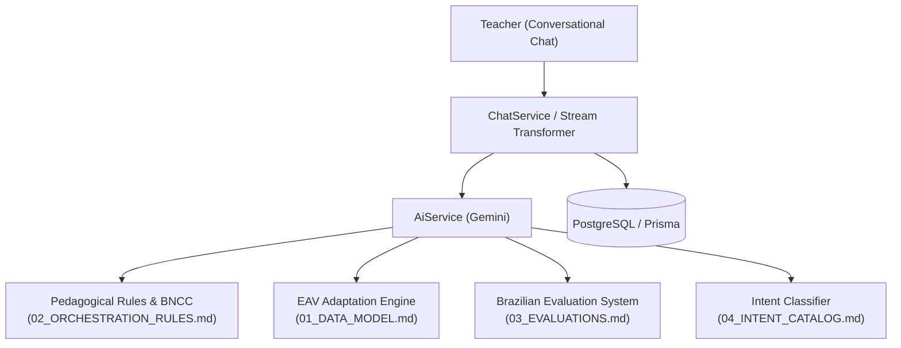

# Lesson Planning Engine — Global Index

This directory defines the **technical, architectural, and pedagogical specifications** for the lesson planning engine in the Teachy platform.

---

## 🎯 Overview

The lesson planning module acts as the authoritative bridge between the teacher's conversational chat interface and structured PostgreSQL persistence via Prisma. The AI operates as an **active pedagogical co-pilot**, subtly guiding the teacher toward comprehensive lesson structure without imposing rigid constraints, adapting to diverse institutional requirements across all stages of Brazilian Basic Education (Early Childhood, Elementary I & II, and High School).

---

## 🧭 Navigation Map

The documentation is modularized into 4 specialized topic guides for rapid inspection by engineers and coding agents:

| Document | Core Focus | When to Consult |
| :--- | :--- | :--- |
| 📖 [**`01_DATA_MODEL.md`**](01_DATA_MODEL.md) | **Relational Modeling, Lean Core & EAV Pattern:** Table structures for `Planning`, `PlanningBlock`, `Specification`, `PlanningMetadataValue`, and `Evaluation`, XOR constraints, and relational integrity. | When modifying Prisma queries, creating backend persistence use cases, or manipulating schema entities. |
| 🧠 [**`02_ORCHESTRATION_RULES.md`**](02_ORCHESTRATION_RULES.md) | **Pedagogical Rules, Guardrails & Context Orchestration:** Default granularity depth rules (Trimester, Month, Week), BNCC linking, date inference, temporal gap management, and mandatory slot-filling. | When designing or calibrating system prompts, dynamic context builders, and AI business rules. |
| 📝 [**`03_EVALUATIONS.md`**](03_EVALUATIONS.md) | **Brazilian Basic Education Evaluation System:** Grading scales (0-10, 0-100, weighted averages, qualitative without grade, bonus points), temporal hierarchies, and `instrumentType` vs `name` catalog. | When implementing evaluation creation, scoring logic, criteria formatting, or assessment extraction. |
| 🎯 [**`04_INTENT_CATALOG.md`**](04_INTENT_CATALOG.md) | **Conversational Intent Catalog & Prisma Mappings:** Teacher intent matrix (date replacement, column disambiguation, recursive tree reorganization, read-only queries, resets) and Prisma mappings. | When implementing intent classification, dual-output stream transformers, or LLM evaluation test suites. |

---

## 🏛️ Domain Invariants

1. **Separation of Core and Adaptation:** The relational core (`Planning` and `PlanningBlock`) remains strictly clean and standardized. All school-specific variations, custom columns, and teacher preferences are absorbed by the `Specification` and `PlanningMetadataValue` engine (Entity-Attribute-Value pattern).
2. **Polymorphism with Strict Integrity (XOR Constraints):** Polymorphic child tables (`learning_objectives`, `planning_metadata_values`, `evaluations`) enforce a database-level XOR check constraint (`(planning_id IS NOT NULL AND planning_block_id IS NULL) OR (planning_id IS NULL AND planning_block_id IS NOT NULL)`), guaranteeing that records belong either to the macro planning header or to a specific planning block, never both and never neither.
3. **Strict Temporal Hierarchy:** No `PlanningBlock` or `Evaluation` timestamp may exceed the temporal boundaries defined in its parent `Planning` (`start_at` and `end_at`).
4. **Zero Technical Payload Leakage & Dual Output Protocol:** Structured persistence payloads, envelopes, and JSON metadata (`<!--PLANNING_PATCH: ... -->`) must be placed strictly at the **tail** of the model's response. The backend stream transformer utilizes a lookahead sliding window buffer to intercept partial opening tokens (e.g. `<!-`, `<!--PLAN`) in real time, preventing technical fragments from leaking to the teacher's streaming view in the chat timeline.
5. **Teacher-to-Teacher Tone & Living Draft UI:** Chat interactions read as a natural, inquisitive, and collegial co-creation between two educators. The AI actively explores didactic paths and asks thoughtful questions while strictly avoiding repeated full-table dumps into the chat. In parallel, an interactive side-panel renders the **Living Draft** of the lesson plan, updating silently in real-time.
6. **Database Snapshot as Single Source of Truth:** Whenever the chat history contains conflicting statements or subsequent teacher revisions (e.g., adding then removing a column, switching a BNCC skill), the current database snapshot takes absolute precedence over historical turns. The AI leverages this snapshot for continuous **Gap Analysis** to drive the next conversational step.
7. **Strict Stream Atomicity & Interruption Resilience:** If the teacher cancels generation mid-flight (`signal.aborted / interrupted: true`), zero planning database mutations are committed; the relational draft state updates only when the complete response finishes and validates without interruption.
