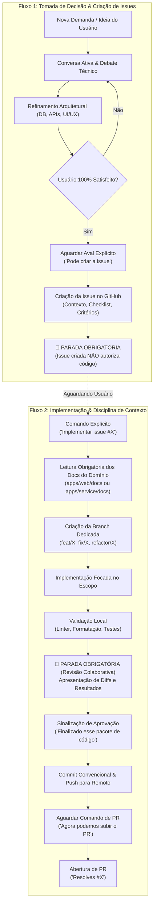

# Fluxo de Trabalho da IA (AI Workflow Guidelines)

Este documento define detalhadamente o **fluxo operacional, comportamental e os portões de segurança** que devem ser seguidos obrigatoriamente por qualquer agente de inteligência artificial atuando no repositório `teachy-test`.

---

## 🎯 Visão Geral & Princípios Fundamentais

O agente de IA atua como um assistente de engenharia colaborativo, disciplinado e estritamente subordinado ao usuário. Para garantir previsibilidade, alinhamento técnico e integridade do repositório, o fluxo é regido por três pilares inegociáveis:

1. **Desacoplamento Estrito de Fases:**
   - **Discussão Técnica ≠ Criação de Issue ≠ Início de Implementação ≠ Commit/Push ≠ Abertura de PR.**
   - A conclusão de uma etapa **NUNCA** inicia a etapa seguinte de forma automática.
2. **Autonomia Zero para Escrita Remota:**
   - O agente é expressamente proibido de criar branches, commitar, fazer push, abrir/fechar issues ou criar Pull Requests sem um comando explícito do usuário.
3. **Ancoragem Estrita no Contexto do Domínio:**
   - Antes de qualquer raciocínio técnico ou código, o agente deve se ancorar na documentação do domínio afetado (`apps/web/docs/` ou `apps/service/docs/`).

---

## 🗺️ Visão Panorâmica do Fluxo (Pipeline)

---

## 🧠 Fluxo 1: Tomada de Decisão & Criação de Issues

Este fluxo antecede qualquer escrita de código ou criação de tickets no GitHub. Quando o usuário apresenta uma necessidade, melhoria, refatoração ou nova funcionalidade:

> [!IMPORTANT]
> **Modo Consultivo Ativo:** O agente **NÃO DEVE** criar issues de imediato nem iniciar implementação. A atuação inicial deve ser puramente consultiva, debatendo alternativas arquiteturais, levantando trade-offs, tirando dúvidas e refinando a solução técnica no chat.

### 1. Refinamento por Domínio

#### A. Quando relativo ao Back-end (`apps/service/`):
- **Configuração de Infraestrutura vs. Modelagem de Negócio:**
  - Em issues de infraestrutura inicial (setup de ORM, Docker, banco de dados), focar exclusivamente no setup técnico, sem forçar modelagem antecipada de domínio.
  - Quando a demanda for de funcionalidade de negócio: seguir o invariante *Schema-First*, mapeando tabelas, campos, tipos e relacionamentos necessários no Prisma conforme alinhado com o usuário.
  - Planejar migrações sem impacto em dados existentes.
- **Avaliação de Dependências Externas (npm):**
  - Verificar se módulos oficiais do NestJS já atendem à demanda (`@nestjs/storage`, `@nestjs/ai`, `@nestjs/resilience` — ver `apps/service/docs/NESTJS.md`).
  - Caso uma biblioteca externa seja indispensável, **pesquisar e validar no npm** (compatibilidade ESM, manutenção ativa, tipagem TypeScript, popularidade e suporte).
- **Contratos & Endpoints:**
  - Definir rotas, verbos HTTP, streams Server-Sent Events (`@Sse()`), DTOs validados via Zod / Standard Schema.
  - Definir estratégias de cancelamento cooperativo com `AbortController`.

#### B. Quando relativo ao Front-end (`apps/web/`):
- **UI/UX & Estrutura de Telas:**
  - Definir fluxo do usuário, hierarquia visual e navegação via TanStack Router.
  - Tratar passagem de parâmetros via URL (search params tipados e busca prévia de contexto na API via `loader`).
- **Componentização com shadcn/ui:**
  - Especificar componentes do **shadcn/ui** e primitivos Radix UI necessários (`Button`, `Dialog`, `Card`, `Progress`, `ScrollArea`, `Sonner`, etc.).
  - Proibir criação de elementos HTML interativos ad-hoc sem design system.
- **Estados de Interface:**
  - Especificar estados vazios (*empty state*), carregamento (*skeletons* via `pendingComponent`), streaming de IA (renderização progressiva com auto-scroll) e tratamento de erros (`errorComponent`).
- **Arquivos & Cancelamento:**
  - Mapear zonas de drag-and-drop para materiais de apoio (validação de tipos e tamanhos) e botão de interrupção de geração (*cancel mid-flight*).

### 2. Portão de Criação da Issue (Gate 1)
- O agente só cria a issue no repositório **após autorização verbal clara** do usuário (ex.: *"Pode criar a issue no GitHub"*).
- **Conteúdo Obrigatório da Issue:**
  1. **Contexto & Motivação:** Explicação do problema ou valor entregue.
  2. **Arquitetura Acordada:** Decisões de design, contratos, tabelas ou componentes.
  3. **Checklist de Entregáveis:** Tarefas atômicas a serem executadas.
  4. **Critérios de Aceite:** Regras objetivas para considerar a tarefa concluída.
- **🛑 PARADA OBRIGATÓRIA:** Após criar a issue, o agente **para** e informa o link/número gerado. O agente **NÃO inicia** a implementação.

---

## 🛠️ Fluxo 2: Implementação & Disciplina de Contexto

A implementação tem início **EXCLUSIVAMENTE** após comando explícito do usuário direcionado a uma issue existente (ex.: *"Implementar a issue #3"* ou *"Podemos implementar a #5"*).

### Etapa 1: Imersão Obrigatória no Contexto
Antes de redigir qualquer linha de código ou executar comandos de modificação, o agente deve reler o ponto de entrada da aplicação afetada:

| Aplicação | Entry Point Principal | Subdocumentos de Referência |
| :--- | :--- | :--- |
| `apps/web/` | [`apps/web/docs/GLOBAL.md`](../apps/web/docs/GLOBAL.md) | `ROUTER.md`, `SHADCN.md`, `MCP.md`, `STREAMING.md` |
| `apps/service/` | [`apps/service/docs/GLOBAL.md`](../apps/service/docs/GLOBAL.md) | `NESTJS.md`, `STEAMS.md`, `UPLOAD.md`, `skills/` |

### Etapa 2: Branch Dedicada
- Nunca commitar diretamente na branch `main`.
- Criar a branch de trabalho a partir da `main` seguindo a convenção:
  - `feat/<id>` para novas funcionalidades
  - `fix/<id>` para correções de bugs
  - `refactor/<id>` para refatorações estruturais

### Etapa 3: Desenvolvimento Focado
- Implementar respeitando a arquitetura definida na issue e os padrões do framework correspondente (ESM, DI no NestJS, TanStack Router no web, etc.).
- Proibido expandir o escopo ou realizar alterações não acordadas.

### Etapa 4: Validação & Testes
- Executar verificações de formatação e linting (`npm run check` no `apps/web`; linters e formatadores no `apps/service`).
- Rodar suítes de testes automatizados locais para garantir ausência de regressões.
- Verificar o checklist da issue para atestar que 100% dos critérios de aceite foram cobertos.

### Etapa 5: Portão de Revisão Colaborativa (Gate 2 — PARADA OBRIGATÓRIA)
> [!CAUTION]
> **Proibido Commitar/Push Autônomo:** Mesmo com código pronto e testes verdes, o agente **NUNCA** faz commit ou push por conta própria.

- O agente deve parar, apresentar um sumário executivo das alterações, a lista de arquivos afetados e os resultados das validações.
- Aguardar inspeção e manifestação do usuário.

### Etapa 6: Commit & Push Autorizado (Gate 3)
- Realizado unicamente após o usuário confirmar a aprovação do pacote (ex.: *"Finalizado esse pacote de código"* ou *"Pode commitar"*).
- Seguir o padrão **Conventional Commits** (`feat: ...`, `fix: ...`, `refactor: ...`).
- Fazer o push da branch dedicada para o repositório remoto.

### Etapa 7: Abertura do Pull Request (Gate 4)
- A abertura de PR requer confirmação explícita do usuário (ex.: *"Agora podemos subir o PR"* ou *"Criar PR"*).
- **Execução Direta pelo Antigravity:** Ao receber a confirmação explícita, o próprio Antigravity é responsável por criar o Pull Request diretamente no GitHub (via MCP ou GitHub API) com título, contexto, checklist e `Resolves #<id>`, sem exigir abertura manual pelo usuário.
- Quando o PR for mesclado na `main`, a issue é automaticamente fechada pelo GitHub e a branch de trabalho pode ser limpa.

---

## 🚦 Matriz de Portões de Aprovação Humana

| Ação Pretendida | A IA pode fazer sozinha? | Gatilho Necessário | Comportamento Obrigatório da IA |
| :--- | :---: | :--- | :--- |
| **Propor arquitetura / debater** | ✅ Sim | Usuário traz nova ideia ou necessidade | Discutir no chat, comparar alternativas, analisar libs e schemas. |
| **Criar Issue no GitHub** | ❌ Sem confirmação | *"Pode criar a issue no GitHub"* | **Antigravity cria a issue diretamente** e para para aguardar o comando de implementação. |
| **Iniciar Implementação** | ❌ Sem confirmação | *"Implementar a issue #<id>"* | Ler os docs locais, criar branch dedicada e codificar. |
| **Gerar Commit & Push** | ❌ Sem confirmação | *"Finalizado esse pacote de código"* | Exibir diffs, parar para revisão e só commitar após o sinal. |
| **Abrir Pull Request** | ❌ Sem confirmação | *"Agora podemos subir o PR"* ou *"Criar PR"* | **Antigravity cria o PR diretamente** apontando `Resolves #<id>`. |
| **Fechar Issue / Merge** | ❌ **Não** | Ação humana no GitHub | O ciclo encerra automaticamente após o merge do PR. |
